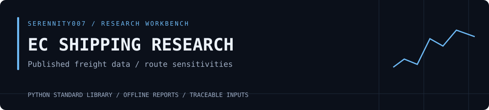

[English](README.md) · [简体中文](README.zh-CN.md)



# EC Shipping Research

Study containerized freight index futures (Europe route, EC), separating route news, carrier quotes and published freight observations before connecting them to a contract.

[Futures research workbench](https://github.com/Serennity007/taotao-futures-research) · [Agent Skill](SKILL.md) · [Language coverage](docs/LANGUAGES.md) · MIT

## Run an offline exercise

Python 3.10+ is required. The scripts use only the standard library.

```bash
git clone https://github.com/Serennity007/ec-shipping-research-skill.git
cd ec-shipping-research-skill
python scripts/run_research.py --config examples/workbench.json --out output
```

Open the printed `REPORT.html` path. You can also inspect the committed [Markdown report](examples/workbench/REPORT.md) or download the [HTML report](examples/workbench/REPORT.html).

The supplied CSV files are synthetic; dates label the exercise. They test calculations and workflow, not a historical trading record. Research reports and reference material currently retain Chinese text; this source release provides English and Chinese entry guides, not an application language switch.

## Check the numbers

The exercise cutoff is January 9. An index observation of 1,400 published on January 10 is excluded. The latest published index is 1,000; the fixture futures quote is 1,200, a difference of 200. Final settlement requires the actual contract rules.

The rerouting scenario assumes a 60-day baseline round trip, 20 extra days and 50% affected capacity. With a fixed fleet, relative capacity is 87.5%. The pressure ratio is about 1.1429 with unchanged cargo volume, or 0.9143 when volume falls 20%. These are conditional arithmetic examples, not forecasts of freight rates or EC returns.

See the [method](references/method.md) for assumptions and additional evidence to check.

## Use your own data

Copy `examples/workbench.json`, then set the instrument, cutoff and file paths. For imported observations, set `data_kind` to `imported_observations` and record a source name and retrieval time for every file. [Fields and configuration](references/workbench.md) also document the original standalone calculation commands.

CSV paths are resolved relative to the configuration file. When running from another directory, use absolute script and configuration paths.

## Save and review runs

Each run creates `output/run-…/`: `REPORT.md` contains the narrative, `bundle.json` the calculation details, and `inputs/` the actual files used. Rerun a saved snapshot in this repository:

```bash
python scripts/run_research.py --config /path/to/previous-run/config.snapshot.json --out output
```

The same inputs should reproduce the calculations. Keep the old run, create a separate run with new data and compare whether the stated conditions occurred. See the [report template](references/report-template.md).

## Use as an Agent Skill

Copy the whole repository to your agent's skill directory, keeping the folder name `ec-shipping-research-skill`. State the data paths, instrument, cutoff and desired response language:

```text
Use $ec-shipping-research-skill with the supplied data, instrument and cutoff.
Run the calculations, distinguish observations from missing evidence,
save the report and explain the results in English.
```

The original Skill instructions remain in Chinese. The response language request does not automatically translate script-generated artifacts.

## Verification and sources

```bash
python -m unittest discover -s tests -v
```

Tests cover calculations, cutoff handling and file I/O. Real-world source identity, units and historical versions still require review. [Official source entry points](references/sources.md) are provided.

The OHLC helper derives from the author's [quant research collection](https://github.com/Serennity007/awesome-stock-quant-skills/tree/67156b0aa4860894a8cdbc66b797db535531fe59/my-skills/gold-cross-asset-research); this repository includes its own code and tests.

Research and learning only; calculations and synthetic examples do not establish trading performance. Original code is distributed under [MIT](LICENSE).
